# Reflexión y Máquinas de interpretación

Aplicación en **Java (Spring Boot)** que instancia figuras geométricas a partir del **nombre de la clase** y de **parámetros enviados en tiempo de ejecución**, y calcula su área y perímetro dinámicamente. Las figuras que la aplicación no trae se cargan y compilan en **Groovy** mientras corre, y también se pueden obtener desde un **servicio externo** (Extra).

Diseño y Arquitectura de Software (ISWZ2202) · Universidad de las Américas (UDLA)

## Proyectos

| Carpeta | Descripción | Puerto |
|---|---|---|
| [`figuras-app`](figuras-app) | Aplicación principal: reflection + carga de clases Groovy en tiempo de ejecución + cliente del servicio externo | 8080 |
| [`servicio-figuras`](servicio-figuras) | Servicio externo (API REST) que entrega la definición Groovy de nuevas figuras | 8081 |

## Requisitos

- JDK 17 o superior (probado con Temurin 21)
- VS Code con *Extension Pack for Java* y *Spring Boot Extension Pack* (o cualquier IDE con Maven)

## Cómo ejecutarlo

1. Abre `TareaFiguras.code-workspace` en VS Code (o abre las dos carpetas).
2. Inicia **primero** `servicio-figuras` (`ServicioFigurasApplication`) y **después** `figuras-app` (`FigurasApplication`), con **Run** sobre el método `main` o desde el *Spring Boot Dashboard*.
3. Abre http://localhost:8080

Con Maven instalado también funciona `mvn spring-boot:run` dentro de cada carpeta.

## Cómo funciona

`FiguraFactory.crear(nombre, parametros)` sigue los 5 pasos de *Reflection paso a paso*:

| Paso | Código | Qué pasa |
|---|---|---|
| 1. El dato | `String nombreClase = "Circulo"` | El nombre llega como texto |
| 2. Cargar la clase | `Class.forName("figuras." + nombreClase, true, cargadorGroovy)` | La JVM busca la clase (Java o Groovy) |
| 3. El constructor | `getDeclaredConstructor(tipos)` | Se elige el constructor cuyos parámetros se llaman igual que los enviados (`radio`) |
| 4. La instancia | `ctor.newInstance(valores)` | Se crea el objeto |
| 5. Polimorfismo | `(Figura) obj` → `calcularArea()`, `calcularPerimetro()` | Desde aquí es polimorfismo normal |

Si la clase no existe, la app consulta el servicio externo, compila el código Groovy recibido con `GroovyClassLoader` y reintenta. Como `Class.forName` recibe el cargador de Groovy, **una clase Groovy funciona igual que una nativa**.

```
Cliente → FiguraController → FiguraFactory ─┬─ figuras.* (Java nativas)
                                            ├─ CargadorGroovy (clases compiladas en ejecución)
                                            └─ ClienteServicioExterno → servicio-figuras (:8081)
```

## Capturas

### Figuras nativas (Java)

| Círculo (radio=5) | Rectángulo (base=4, altura=6) |
|---|---|
| 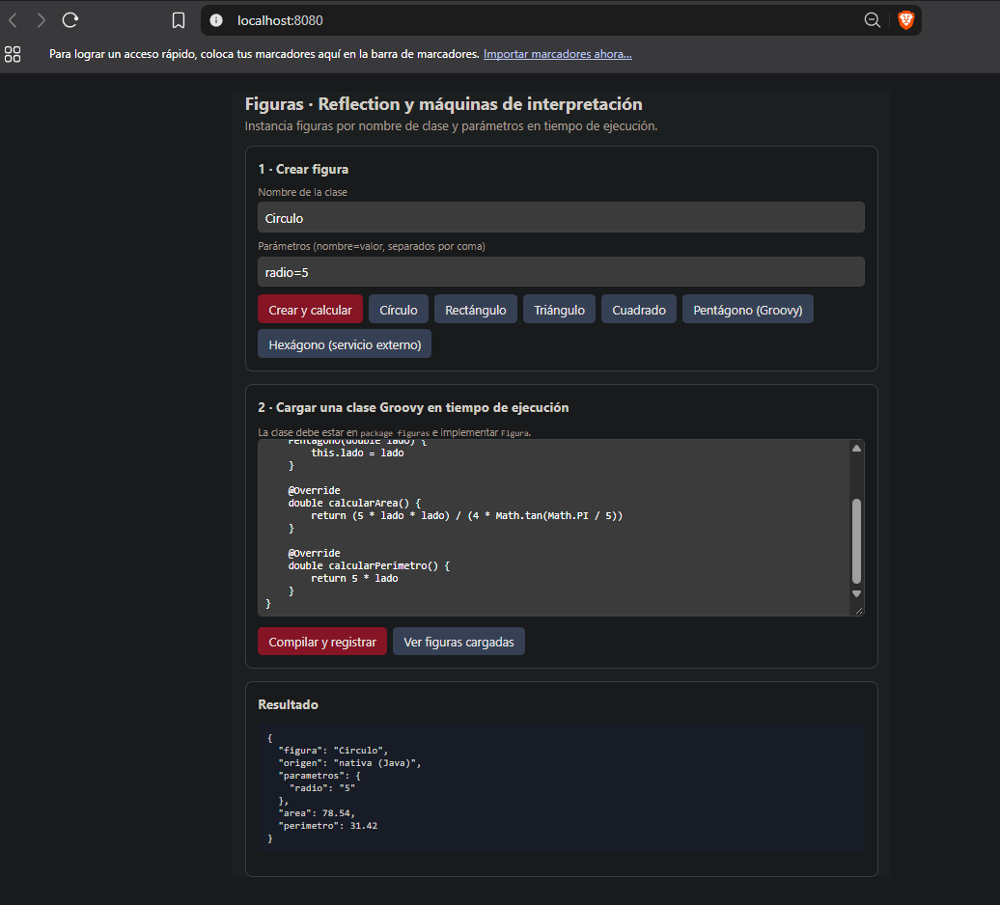 | 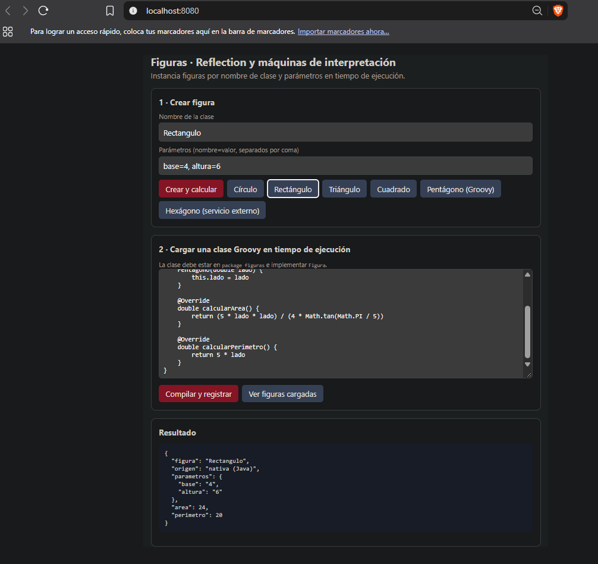 |

| Triángulo (base=8, altura=3) | Cuadrado (lado=2) |
|---|---|
| 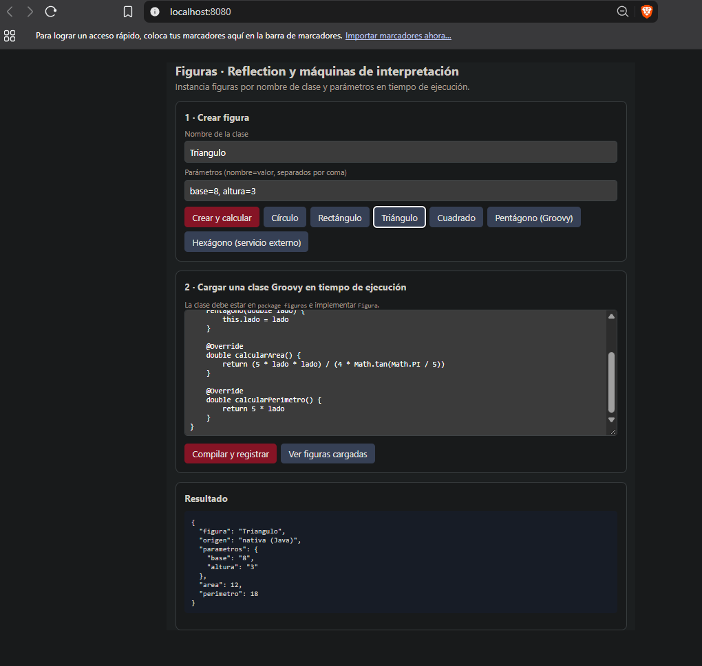 | 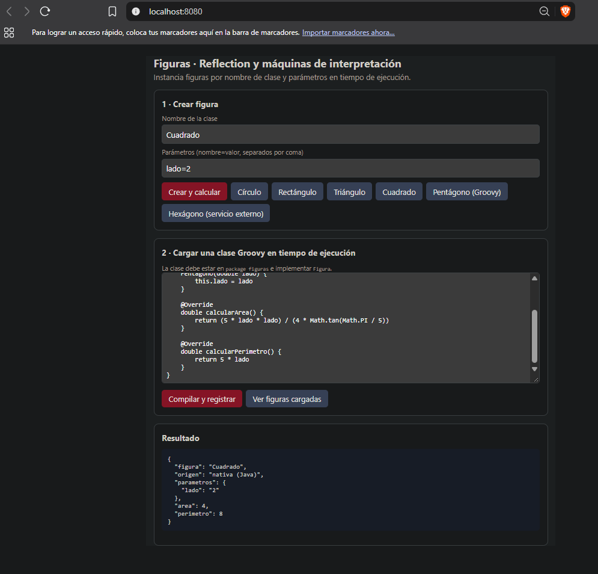 |

### Figura cargada en Groovy en tiempo de ejecución

Antes de compilar, la clase `Pentagono` no existe y la app responde con un error controlado:

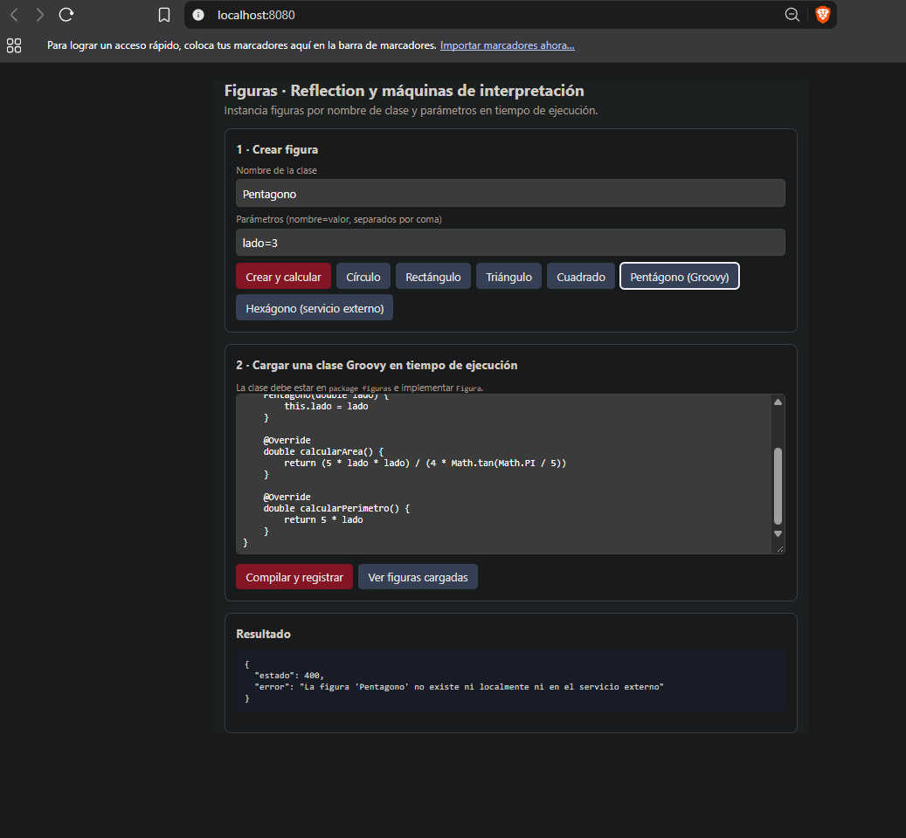

Después de pulsar **Compilar y registrar**, funciona como una clase nativa:

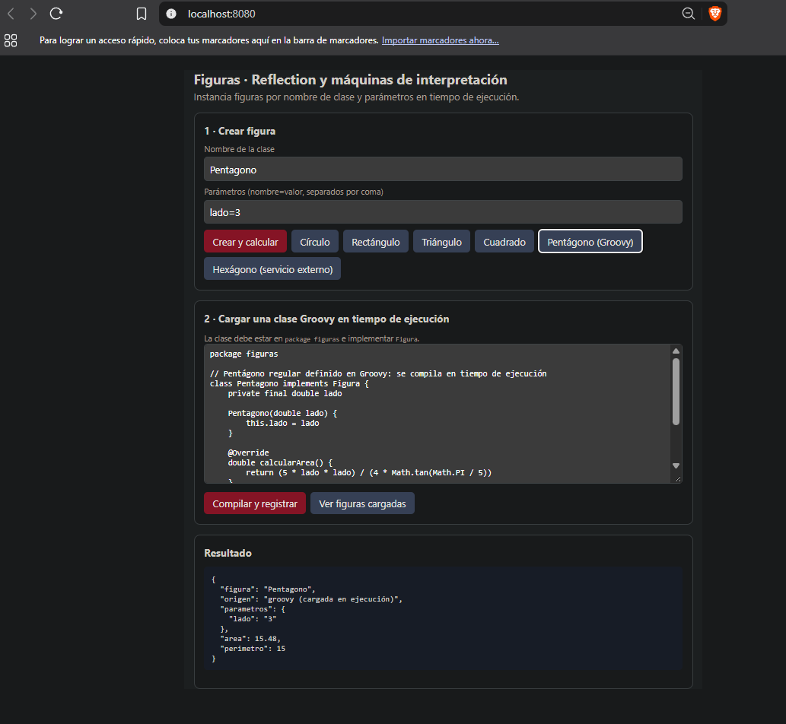

### Extra: servicio externo

La app no tiene `Hexagono`. Lo pide al servicio externo, que responde con su definición (`nombre`, `parametros`, `codigo`):

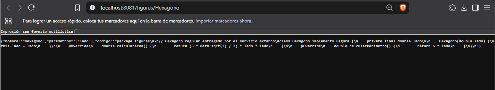

La app compila ese código y lo usa (`origen: servicio externo`):

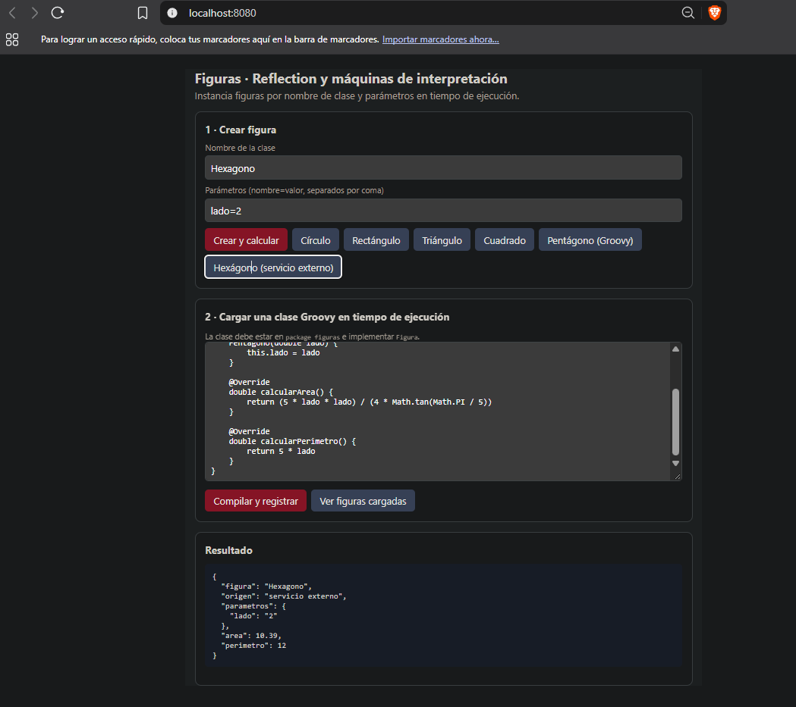

Registro de las figuras cargadas en ejecución y su origen:

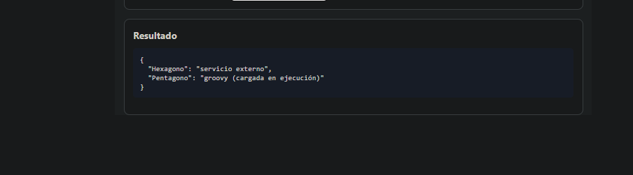

### Consolas

Servicio externo en el puerto 8081:

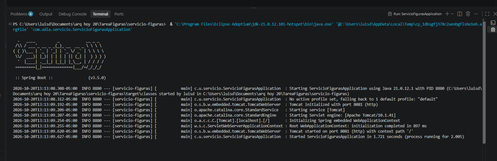

Aplicación en el puerto 8080:

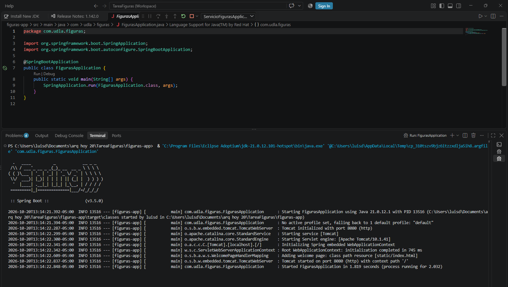

## Resultados de referencia

| Figura | Parámetros | Área | Perímetro | Origen |
|---|---|---|---|---|
| Circulo | radio=5 | 78.54 | 31.42 | nativa (Java) |
| Rectangulo | base=4, altura=6 | 24 | 20 | nativa (Java) |
| Triangulo | base=8, altura=3 | 12 | 18 | nativa (Java) |
| Cuadrado | lado=2 | 4 | 8 | nativa (Java) |
| Pentagono | lado=3 | 15.48 | 15 | Groovy |
| Hexagono | lado=2 | 10.39 | 12 | servicio externo |

## Endpoints

| Método | URL | Uso |
|---|---|---|
| GET | `/api/figuras/crear?nombre=Circulo&radio=5` | Crear figura desde el navegador |
| POST | `/api/figuras/crear` — `{"nombre":"Circulo","parametros":{"radio":5}}` | Crear figura |
| POST | `/api/figuras/groovy` — texto plano con el código | Compilar y registrar una clase Groovy |
| GET | `/api/figuras/cargadas` | Figuras cargadas en ejecución y su origen |
| GET | `http://localhost:8081/figuras` | Catálogo del servicio externo |
| GET | `http://localhost:8081/figuras/{nombre}` | Definición `{nombre, parametros, codigo}` |

## Notas

- El triángulo se asume **isósceles** para calcular su perímetro con base y altura.
- Las clases Groovy deben declarar `package figuras` e implementar `Figura`.
- Las figuras cargadas viven mientras la aplicación está corriendo; al reiniciarla se pierden.
- Ejecutar código descargado es un riesgo de seguridad: la app solo consulta la URL configurada en `application.properties` (`servicio.figuras.url`).
